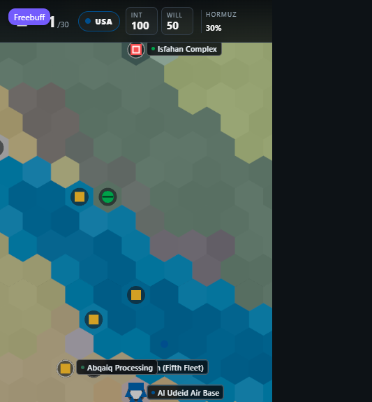

# Chokepoint

A mobile-first, single-player, turn-based strategy game about the 2026 Gulf war. You command the
United States, Israel or Iran over thirty turns while allied host nations decide, one missile impact
at a time, whether they still want you on their soil.

Built with TypeScript (strict), Phaser 4, Vite and Vitest. The map is a 79 × 70 hex theatre of the
Middle East (26°E–78°E, 8°N–44°N); the interface is a DOM overlay above the canvas so text stays
sharp and accessible.



## Quick start

```bash
corepack pnpm install     # pnpm 10 via corepack
corepack pnpm dev         # http://localhost:5173
corepack pnpm test        # 141 unit/integration tests
corepack pnpm build       # typecheck + production bundle in dist/
corepack pnpm preview     # serve the production build
```

Node 20+ is required. If `pnpm` is not on PATH, use `corepack pnpm …` — this repository pins
`pnpm@10.15.0`.

## Playing

Tap a hex, a base label or one of your own units to open its card. Selecting a strike aircraft puts
its **strike targets in range** at the top of the card as big one-tap buttons — name, distance,
integrity and a `BURIED`/`HARDENED` badge — so an attack is select → tap target. `ATTACK` mode still
works too if you prefer picking the hex on the map. Actions appear contextually:

| Action | Who | Effect |
| --- | --- | --- |
| Strike | USA / Israel / Iran | Attack a hostile base, city or unit stack within range |
| Move | all | Reposition within the unit's movement allowance (ground cannot enter water) |
| Special ops | USA SOF | Sabotage a facility; failure costs legitimacy |
| Cyber | Israel, Unit 8200 | Remove one Iranian launcher; three-turn cooldown |
| Produce | Iran | Spend war resources on drones and missiles |
| Diplomacy | USA | Spend political will to lower a host nation's threat perception |
| Reinforce | USA | Order CONUS packages (interceptors, Patriot, THAAD, squadron, second CSG) |
| Airlift | USA | Divert airlift to Israel for +15 interceptors |

`END TURN` resolves the turn: your orders, then the AI military phase, then attrition, production,
politics, chokepoint economics and the victory check. Each turn is written to the log, and the whole
campaign autosaves.

**Controls.** Drag to pan, pinch or mouse-wheel to zoom, tap to select, double-tap to zoom in,
long-press for an explanation of whatever is under your finger (a 450 ms press also opens the hex
card directly). The side stack zooms (`+`, `−`), re-centres (`◎`), cycles **my forces** (`⚑`), jumps
to the **next threat** (`⚠`), toggles the **minimap** (`▣` — tap it to relocate the camera) and
opens the **jump drawer** (`⌖`): a bilingual, filterable list of every named location. Keyboard:
arrows pan, `+`/`−` zoom, `N` next unit, `T` next threat, `J` jump, `M` minimap, `Escape` closes.
Valid strike targets are highlighted on the map in attack mode — hardened and deeply buried sites
carry an amber marker. `prefers-reduced-motion` is honoured throughout. The turn report that follows
`END TURN` can be skipped to its summary or closed at any time; `Escape` closes it too.

**Language.** The `فا` / `EN` button in the header switches between English and Persian. Persian runs
the whole interface right-to-left, with translated menus, unit and facility names, effects, tutorial
and report chrome. Battle-log, resolution and outcome lines render through **named-variable Persian
templates** (`src/i18n/log.ts`); rare unmatched lines keep the English original, and both screens say
so. The English originals stay in the snapshot, so replays stay byte-identical.

### The six-phase design pass (v0.2)

The v0.2 roadmap replaced the original turn-clock victory with measurable systems. Every threshold
lives in scenario data (`src/data/scenarios.json`, `src/data/logistics.json`), every interpretive
choice is logged in `DESIGN.md` under *Decisions*, and the full test suite (`corepack pnpm test`)
asserts the lot. In order:

1. **Four Iranian victory paths** — regime survival with a nuclear-integrity floor, no occupation,
   an oil-shock index with a sustained-disruption term, and degraded Israeli offensive capacity.
2. **US domestic constraints** — one pressure gauge driven by congressional support and economic
   pressure; announced (never silent) restrictions on US operations; casualty reports with
   congressional responses; economy-driven sustainment cuts; a public-address order; and a
   domestic-collapse defeat for Washington.
3. **Logistics, Israeli initiative, Qatar talks** — reinforcement transits as data; an Israeli AI
   initiative track the US player can approve, constrain or accept; a Qatar-mediated ceasefire
   state machine that ends the campaign with a tiered armistice.
4. **Fog of war (presentation only)** — enemy facility integrity, unit strength and launcher counts
   show deterministic estimate bands, narrowed by MQ-9 / special-operations reconnaissance. The
   engine snapshot is never touched, so replays stay byte-identical.
5. **Navigation and targeting** — minimap with tap-to-jump, bilingual jump drawer with search and
   filters, my-forces / next-threat cycling, shared strike-target discovery driving both the target
   list and the map overlay, long-press hex info, full keyboard support, ARIA labels and
   `prefers-reduced-motion`.
6. **Content and localisation** — Persian named-variable templates for log, resolution and outcome
   lines; `label_fa` fields on logistics data; save/replay format v2 with a v1 migration.

### The four improvements (v0.3)

The v0.3 pass layered the owner-picked priority improvements on top, following the same rules —
thresholds in scenario data, interpretive choices in `DESIGN.md`, determinism never sacrificed:

1. **Escalation ladder & red lines** — the nuclear-escalation meter now reads as a five-rung data
   ladder (`campaign.escalation`); every rung drags great-power hostility and host-nation threat a
   little further each turn. Named red lines — nuclear use, leadership decapitation, a destroyed
   nuclear complex, a strangled strait — fire exactly once, applying a numbered consequence package
   (escalation jump, great-power hostility, US political-will drop, Iranian mobilisation) and are
   tracked in the snapshot. The strategic panel shows the rung and every crossed line.
2. **Logistics depth** — reinforcement transits now respond to the sea lane: while Hormuz disruption
   sits above the scenario threshold, every in-transit shipment slips one turn per turn (capped),
   with a visible `+N strait delay` badge and a forward warning when ordering into a burning strait.
3. **Rules-of-engagement presets** — the coalition player picks constrained / standard / aggressive
   as a free order. Constrained forbids population-centre strikes, halves the escalation signature
   and buys +1 congressional support a turn; aggressive buys +15% strike damage at ×1.5 escalation,
   −1 congress and +1 host-nation threat a turn. The posture binds every US and Israeli formation,
   player or AI.
4. **Graded settlement** — every terminal campaign also produces a six-axis scorecard (three axes
   per side, weights in scenario data). Both totals normalize to 0-100 and the margin yields a
   graded verdict — decisive / clear / narrow win per side, or stalemate on points — rendered as a
   table in the outcome modal.

v0.3 also fixes a baseline gap: the great-power response loop (`updateSuperpowers`) existed from the
start but was never called by the turn pipeline; it now runs right after the escalation phase, so
the arms-pipeline → shield → no-fly-zone tiers actually respond to play.

### Factions

- **United States** — expeditionary air power, a finite interceptor magazine, and a basing network
  that can be withdrawn by its hosts. Win by destroying Isfahan, Natanz and Fordow, or by pushing
  Iran's war cost past its threshold while the Gulf bases hold.
- **Israel** — defensive attrition. Keep cities intact, keep interceptors in the magazine, and break
  Iran's launch force before turn 25.
- **Iran** — asymmetric endurance. Strangle Hormuz, survive thirty turns with the regime and the
  nuclear complex intact, or drive US political will to zero.

AI-controlled states (Saudi Arabia, the UAE, Qatar, Kuwait, Bahrain, Jordan, Egypt, Turkey, the
Houthis) run a deterministic behaviour-tree phase each turn: they retaliate, restrict base access,
close facilities, mediate, or intervene.

### Systems

- **Host-nation politics.** Strikes that land on a host's soil raise its threat perception. Above a
  per-country threshold it restricts offensive missions; above a second threshold it closes its
  bases for several turns. Kuwait restricts earliest; Turkey needs high US legitimacy to open
  Incirlik at all.
- **Interceptor economy.** Patriot, THAAD, Arrow-2/3, David's Sling, Iron Dome and Iron Beam draw
  from shared magazines. Saturation salvos degrade interception. Every interception has a price.
- **Buried facilities.** Natanz's enrichment hall sits 25 m down and Fordow's 60 m down, inside a
  mountain. A warhead only damages the halls if its penetration reaches that depth, so F-15s, F-35s,
  B-52s, drones and cruise missiles can wreck surface plant but cannot push those two sites below
  55% integrity. The B-2's GBU-57 MOP (60 m of penetration) is the only weapon in the theatre that
  can destroy them, and it carries one bomb every four turns. Isfahan is hardened but not buried.
- **Sortie limits and damage control.** Each unit flies at most one mission per turn, and air
  magazines rearm slowly (+2/turn), so a strike today is a strike you cannot make tomorrow. Friendly
  airfields repair 5 integrity per turn while they are manned; a base reduced to zero stays down.
- **Chokepoints.** Anti-ship batteries and fast attack craft near Hormuz, minefields, and coalition
  naval presence set a disruption percentage that moves the oil price and every Gulf state's threat
  perception. Sustained disruption closes Suez and eventually brings Indian and Qatari pressure.
- **Third parties.** Pakistan may intervene defensively if Saudi oil and Riyadh are hit hard; Egypt
  closes Suez; India applies diplomatic pressure; Qatar offers mediation.
- **Determinism.** All randomness comes from a per-turn, per-faction mulberry32 stream seeded from
  the campaign seed, so a campaign replays exactly from its order log.

## Scenarios

| Id | Name | Turns | Notes |
| --- | --- | --- | --- |
| `campaign` | The Narrow Sea | 30 | Full theatre, all three factions playable |
| `tutorial` | First Strike | 5 | Scripted Iranian response; win by holding three operational Gulf bases |

## Project layout

```
src/
  main.ts              Phaser bootstrap, PWA registration, perf hooks
  core/                config, types, RNG, world helpers, Game singleton, turn engine
  map/                 hex maths, geography, terrain sampling, chunk renderer, markers
  combat/              strike validation/resolution, interception, sabotage, cyber
  politics/            Hormuz, host nations, third parties, victory conditions
  ai/                  behaviour-tree interpreter, AI actions, tutorial script
  scenes/              MapScene: camera, input, chunk streaming, pan benchmark
  ui/                  DOM overlay, event bus, styles
  i18n/                English/Persian dictionary, language state, RTL application
  data/                map nodes, unit rosters, scenarios, AI trees (JSON, with fa fields)
scripts/make-icons.mjs PNG icon generator for the PWA manifest
public/                manifest, service worker, icons
```

## Performance

Measured on this machine (Windows, desktop Chromium, 390 × 844 CSS pixels, DPR 1), production build:

| Asset | Size | Gzip |
| --- | --- | --- |
| App JS (`index-*.js`) | 152.1 kB | 49.2 kB |
| Phaser 4 (vendor chunk, loaded at boot) | 1367.1 kB | 357.0 kB |
| CSS | 22.3 kB | 5.2 kB |
| **Initial payload** | — | **≈ 411 kB** |

That is inside the 500 kB gzip budget, but only just, and Phaser accounts for ~90% of it.

Frame rate while the render loop ran with the map streaming chunks: 60–67 fps at the same viewport
(`window.__choke.stats().fps`). `window.__choke.panBench(2500)` sweeps the camera across the Gulf and
returns `{ fps, minFps, p95FrameMs, samples }` for repeatable measurement; it needs a visible tab
because Chromium throttles `requestAnimationFrame` for hidden pages.

The map keeps draw calls flat: each 16 × 16 chunk is painted once into an offscreen canvas, uploaded
as a single texture and drawn as one quad. Only chunks in the camera viewport plus a one-chunk ring
are retained; the ring is built two chunks per frame so panning never stalls a frame.

**This has not been measured on physical mobile hardware.** The numbers above are desktop Chromium
with a mobile-sized viewport, which is a weaker test than a Pixel 5 or an iPhone.

## Persistence

`localStorage` holds an autosave plus three manual slots. Save files are **format v3** (v0.3);
v1 (original build) and v2 (v0.2) saves load and are migrated in place on load — the normalizer
fills every newer snapshot block (domestic, initiative, ceasefire, escalation, logistics, ROE,
scorecard weights) with scenario defaults, never overwriting present values. `exportReplay` writes
a JSON bundle of the seed and order log (format v3 — the payload semantics are unchanged, so old
replays still reproduce their campaigns); `replayOrders` in `src/core/engine.ts` re-runs a campaign
from it, and the determinism test asserts two identical seeds produce byte-identical snapshots.

## Offline

`public/manifest.webmanifest` and `public/sw.js` make the production build installable and playable
offline after the first visit; the service worker is registered only in production builds. Icons are
generated with `node scripts/make-icons.mjs` (no image dependencies).

## Tests

```
src/map/hex.test.ts        coordinate round-trips, distances, ranges
src/map/terrain.test.ts    water/land sampling, node placement, ownership
src/core/engine.test.ts    setup, order validation, determinism, reachability of nuclear sites
src/core/campaign.test.ts  full 30-turn runs for all three factions, save/load round-trip,
                           buried-hall penetration (conventional vs. B-2 MOP), great-power red lines
src/politics/victory.test.ts    the four Iranian victory paths and their thresholds
src/politics/domestic.test.ts   the US domestic-pressure system
src/politics/phase3.test.ts     Israeli initiative track and Qatar talks
src/politics/escalation.test.ts the escalation ladder and its red lines
src/politics/logistics.test.ts  in-transit strait-risk delays
src/politics/roe.test.ts        rules-of-engagement presets
src/politics/scorecard.test.ts  the graded multi-axis settlement
src/ui/fog.test.ts         estimate bands and reconnaissance narrowing
src/ui/nav.test.ts         navigation drawer, filters, cycling
src/i18n/log.test.ts       Persian named-variable templates and outcome coverage
```

## Known limitations

- Single-player only; no networking or cloud saves.
- The turn "cinematic" is a skippable overlay that paces event playback, not rendered footage.
- Replay is export-only: there is no in-game replay viewer, though the engine can re-run logs.
- Qatar's mediation is modelled as an automatic event rather than a player choice.
- Save files are versioned; v1 and v2 migrate forward through the normalizer, but there is no
  migration path beyond rejecting unknown future versions.
- Persian covers the whole interface and renders simulation lines through named-variable templates;
  a rare unmatched engine line keeps its English original and the UI says so.
- The four v0.3 balance presets (escalation rungs, strait-risk thresholds, ROE multipliers,
  scorecard weights) are first-pass values pending a playtest pass on real hardware.
- Pointer/gesture handling is driven manually in desktop Chromium at 390 × 844 (menu → unit →
  target-list strike → END TURN → report skip/close); mobile touch was not tested on a real device.
